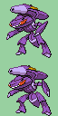

# No.0649 盖诺赛克特

盖诺赛克特#0649

虫 钢

<table class="ib-t"><tr><th>全国图鉴号</th><td>0649</td></tr><tr><th>分类</th><td>古生代</td></tr><tr><th>种族值合计</th><td>600</td></tr><tr><th>成长率</th><td>慢</td></tr><tr><th>蛋组</th><td>未发现</td></tr><tr><th>雌性比例</th><td>无性别差异</td></tr><tr><th>捕获率</th><td>3</td></tr><tr><th>基础亲密</th><td>0</td></tr></table>

<a href="#stats">种族值</a><a href="#matchup">相性</a><a href="#ability">特性</a><a href="#moves">招式池</a><a href="#forms">形态</a>

3亿年前就存在的宝可梦。被等离子队改造，背上安装了炮台。

## 种族值 {#stats}

<table class="statbar-t">
<tr><th>HP</th><td class="num">71</td><td>
<i style="width:36%;background:#63bb63"></i>
</td></tr>
<tr><th>攻击</th><td class="num">120</td><td>
<i style="width:60%;background:#e0b93c"></i>
</td></tr>
<tr><th>防御</th><td class="num">95</td><td>
<i style="width:48%;background:#d2794a"></i>
</td></tr>
<tr><th>特攻</th><td class="num">120</td><td>
<i style="width:60%;background:#45b8c8"></i>
</td></tr>
<tr><th>特防</th><td class="num">95</td><td>
<i style="width:48%;background:#5b7dc6"></i>
</td></tr>
<tr><th>速度</th><td class="num">99</td><td>
<i style="width:50%;background:#b467c4"></i>
</td></tr>
<tr class="total"><th>总和</th><td class="num">600</td><td>
<i style="width:100%;background:#8a97a8"></i>
</td></tr>
</table>

## 相性（防守侧） {#matchup}

| 倍率 | 攻击属性 |
|---|---|
| **4×** | 火 |
| **1×** | 地面 岩石 格斗 水 电 飞行 |
| **1/2×** | 一般 冰 幽灵 恶 虫 超能力 钢 龙 |
| **1/4×** | 草 |
| **免疫** | 毒 |

## 特性 {#ability}

| 槽位 | 特性 | 游戏内描述 |
|:---|:---|:---|
| 第一特性 | **[下载](../abilities/下载.md)** | 根据情况提升攻击或特攻 |

## 招式池 {#moves}

本作可通过回忆系统获得的**全部合法招式**，共 **86** 个（按招式编号序）。

展开查看全部 86 个合法招式

飞翔、喷射火焰、冰冻光束、暴风雪、破坏光线、日光束、十万伏特、电磁波、打雷、剧毒、精神强念、电光一闪、刺耳声、影子分身、光墙、反射壁、玉石俱碎、高速星星、火箭头锤、汲取、闪光、大爆炸、睡觉、三重攻击、劈开、替身、打鼾、守住、电磁炮、锁定、终极吸取、挺住、虚张声势、连斩、梦话、报恩、迁怒、金属爪、觉醒力量、神速、原始之力、暗影球、硬撑、魔法反射、回收利用、秘密之力、火焰踢、金属音、信号光束、燕返、铁壁、电击波、重力、急速折返、恶意追击、珍藏、电磁飘浮、岩石打磨、恶之波动、十字剪、虫鸣、能量球、终极冲击、暗影爪、意念头锤、加农光炮、垃圾射击、铁头、磁铁炸弹、虫咬、充电光束、磨爪、意念移物、蓄能焰袭、单纯光束、轮唱、交换场地、换档、虫之抵抗、电网、高科技光炮、致命针刺、密语、纠缠不休、猛扑、铁蹄光线

## 形态 {#forms}

无（本编号在本作只有一个可用形态）

<a href="../0648-美洛耶塔/">← #0648 美洛耶塔</a>
<a href="../">图鉴目录</a>

